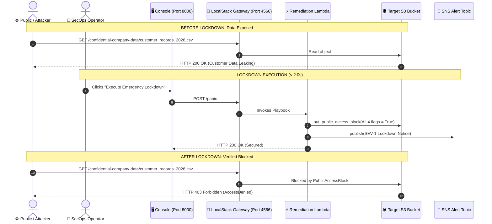

# Product No. 37: Incident Response Panic Button
> **Automated Cloud Incident Response Playbook for AWS & LocalStack**  
> *Cloud Computing Project*

---

## 🛡️ Overview
* **The Problem:** When an Amazon S3 bucket is accidentally made public or credentials leak, manually navigating the AWS Console to locate the bucket and block public access takes critical minutes.
* **The Solution:** A single-click emergency containment tool that enforces an S3 Public Access Block, alerts the team via Amazon SNS, and produces an audit record in under two seconds.
* **Proof of Lockdown:** Evaluators can directly observe the public S3 URL switch from **HTTP 200 OK (leaking data)** to **HTTP 403 Forbidden (`AccessDenied`)** in real time.

---

## 🌐 Port Architecture & Services

| Port / Address | Service / Purpose | What You Can Inspect Here |
| :--- | :--- | :--- |
| **`http://localhost:8080`** *(or `8000`)* | **Web Console & Dev Server** | Clean containment UI, lockdown trigger, and live public access inspector. |
| **`http://localhost:8080/verify-access`** | **Verification Probe Endpoint** | Returns live JSON indicating whether public access is allowed (200) or denied (403). |
| **`http://localhost:4566`** | **LocalStack Edge Gateway** | Emulates AWS Cloud services (S3, Lambda, API Gateway, SNS, IAM, CloudWatch). |
| **`http://localhost:4566/_localstack/health`** | **LocalStack Healthcheck** | Inspects operational status of all active AWS services. |
| **`4510-4559`** | **LocalStack Service Ports** | Dynamically allocated ports for external AWS service bindings. |

---

## 👤 Project Credits & Developer Details

| Developer Name | Hall Ticket No | Role & Deliverables |
| :--- | :---: | :--- |
| **Gaurav Kumar** | `2503A52928` | **Full-Stack Cloud & Incident Response Lead** — End-to-end implementation (SecOps Console UI, API Gateway & Dev Server, Python/Boto3 Lambda Remediation Playbook, LocalStack Cloud Architecture, and Automated Test Suite). |

---

## 🏗️ Architecture & Verification Flow



---

## 🚀 How to Run & Verify

### Step 1: Start the Development Server
```bash
python3 backend/mock_server.py
```
Open **`http://localhost:8080`** in your browser.

### Step 2: Observe the Exposed State (Before Lockdown)
* Look at the **Lockdown Verification** card at the bottom.
* It shows **`200 OK · Publicly Accessible`** with a preview of the customer records.
* You can also verify via terminal:
  ```bash
  curl -i http://localhost:8080/verify-access
  ```

### Step 3: Trigger Emergency Lockdown
1. Check **Arm trigger to enable emergency lockdown**.
2. Click **Execute Emergency Lockdown**.
3. In under 200ms, the status updates to **`Locked Down (Secured)`**.

### Step 4: Verify Public Access is Denied (After Lockdown)
* The **Lockdown Verification** card automatically updates to **`403 Forbidden · Access Denied`**.
* The response payload immediately switches to `<Code>AccessDenied</Code>`.
* Confirm via terminal:
  ```bash
  curl -i http://localhost:8080/verify-access
  ```
  *(Returns `403 Forbidden` proof)*

---

### Running with LocalStack Locally & Docker for EC2
The server boots both the local AWS compatibility engine (port 4566) and the live EC2 Docker container (port 9345) automatically:

1. **Start the Environment & Console:**
   ```bash
   python backend/mock_server.py
   ```
2. **Access the Console:**
   Open **`http://localhost:8080`** (or the port displayed in terminal) in your browser.
3. **Connect to the EC2 Instance (Port 9345):**
   * PowerShell: `.\connect_ec2.ps1`
   * Command Prompt: `connect_ec2.cmd`
   * Bash / Linux / macOS: `./connect_ec2.sh`
4. **View Live SNS Incident Alerts:**
   * Python: `python read_sns.py`
   * PowerShell: `.\read_sns.ps1`
   * Bash: `./read_sns.sh`
5. **Inspect Public S3 Access Directly:**
   * Before lockdown: returns `200 OK`
   * After lockdown: returns `403 Forbidden` (`AccessDenied`)
   ```bash
   curl -i http://localhost:4566/confidential-company-data/customer_records_2026.csv
   ```

---

## 🧪 Automated Tests

Run the test suite:
```bash
python3 -m unittest discover tests
```
Output:
```text
....
----------------------------------------------------------------------
Ran 4 tests in 0.013s

OK
```
